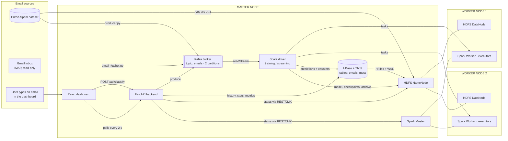
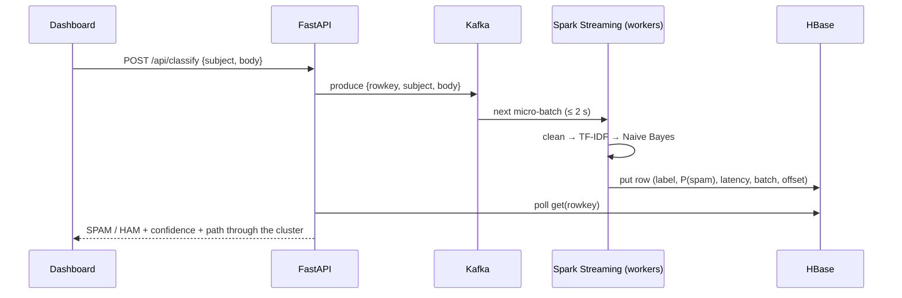
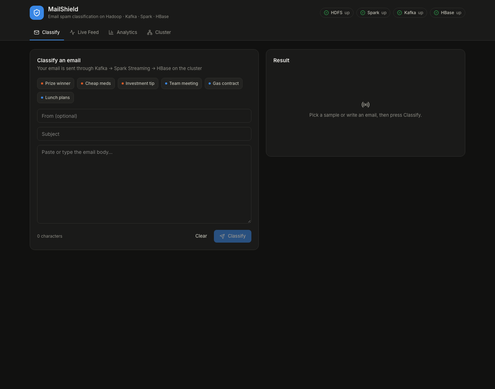
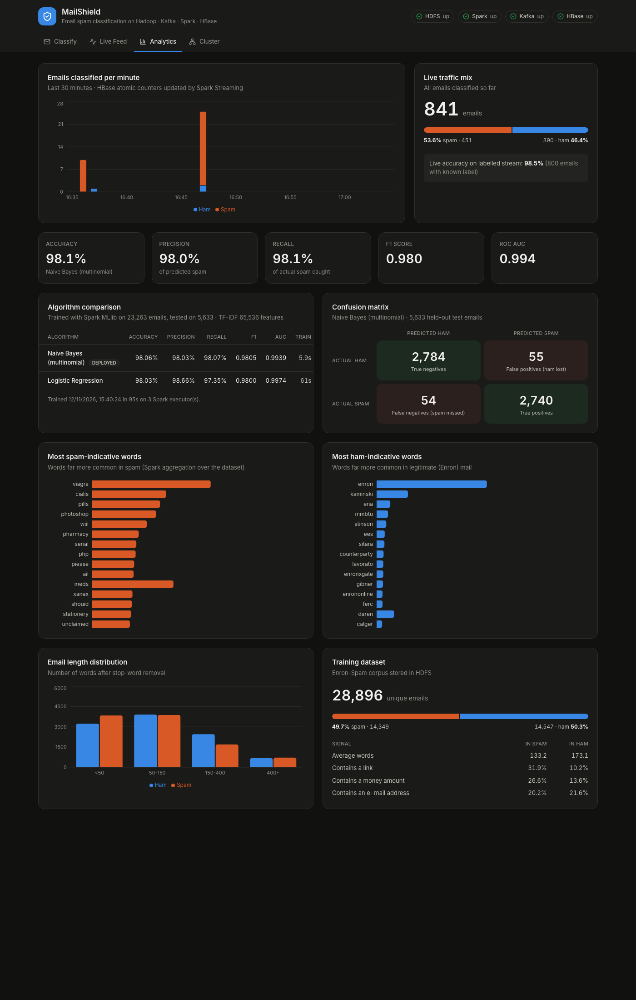

# MailShield: Email Spam Classification Using Big Data Technologies

**A real-time, distributed email spam classifier built on Hadoop HDFS, Apache Kafka, Apache Spark (MLlib + Structured Streaming) and Apache HBase, running on a three-machine cluster with a React dashboard.**

| | |
|---|---|
| **Cluster** | 3 MacBooks: 1 Master Node + 2 Worker Nodes |
| **Technologies** | Hadoop HDFS 3.3.6 · Apache Spark 3.5.9 (PySpark, MLlib, Structured Streaming) · Apache Kafka 3.9.1 · Apache HBase 2.5.16 · FastAPI · React + Tailwind CSS |
| **Dataset** | Enron-Spam corpus: 33,716 labelled emails |
| **Model** | TF-IDF + Multinomial Naive Bayes (compared with Logistic Regression) |
| **Result** | **98.06 % accuracy, F1 = 0.981** on 5,633 held-out emails · **98.5 % live accuracy** on the streaming pipeline |

---

## Table of contents
1. [Abstract](#1-abstract)
2. [Introduction](#2-introduction)
3. [Objectives and scope](#3-objectives-and-scope)
4. [Mapping to the project requirements](#4-mapping-to-the-project-requirements)
5. [Technology stack](#5-technology-stack)
6. [System architecture](#6-system-architecture)
7. [Cluster setup (Master and Worker nodes)](#7-cluster-setup-master-and-worker-nodes)
8. [Dataset](#8-dataset)
9. [Methodology: machine learning pipeline](#9-methodology-machine-learning-pipeline)
10. [Implementation](#10-implementation)
11. [User interface](#11-user-interface)
12. [Results](#12-results)
13. [Testing](#13-testing)
14. [Challenges faced and solutions](#14-challenges-faced-and-solutions)
15. [Limitations](#15-limitations)
16. [Future scope](#16-future-scope)
17. [Conclusion](#17-conclusion)
18. [How to run the project](#18-how-to-run-the-project)
19. [Project structure](#19-project-structure)
20. [Team](#20-team)
21. [References](#21-references)

---

## 1. Abstract

Spam makes up a large share of global email traffic and is a common vehicle for fraud and phishing.
Large email providers must filter **billions of messages per day**, which no single machine can do.
They need distributed storage, distributed computation and high-throughput message queues.

This project builds a working, end-to-end spam filtering system using the Hadoop ecosystem
on a real **three-computer cluster**:
- **Kafka** queues incoming emails.
- **Spark** trains a machine-learning model in parallel on the worker nodes and classifies the incoming emails in real time.
- **HBase** stores every prediction for fast lookup.
- **HDFS** stores the dataset, the trained model and all intermediate data, replicated across the workers.

A **React dashboard** lets users classify their own emails, watch the live stream, read analytics,
monitor the cluster, and classify messages from a **real Gmail inbox**.

The deployed Multinomial Naive Bayes model reaches **98.06 % accuracy** (precision 98.03 %,
recall 98.07 %, ROC-AUC 0.994) on held-out data. It classifies a streamed email in about 2–4 seconds end to end.

---

## 2. Introduction

### 2.1 Problem statement
Given the subject and body of an email, decide whether it is **Spam** (unwanted, promotional or fraudulent)
or **Ham** (legitimate), and do so:
- **continuously**, as emails arrive, not in one offline batch;
- **at scale**, so that adding machines increases capacity without code changes;
- **transparently**, so that every decision is stored and can be inspected later.

### 2.2 Why Big Data technologies?
| Real-world need | Technology that solves it |
|---|---|
| Emails arrive continuously and in bursts; none may be lost if a component restarts | **Kafka**: durable, partitioned message queue |
| Training data and archives are too big for one disk and must survive machine failure | **HDFS**: distributed, replicated file system |
| Training and classification must run in parallel on many machines | **Spark**: distributed in-memory processing, MLlib, Structured Streaming |
| Billions of results must be written and looked up by ID in milliseconds | **HBase**: distributed NoSQL key-value store on top of HDFS |

Our dataset (33,716 emails, 51 MB) is small by industry standards. The aim is to show an
**architecture that scales horizontally**: the same code runs unchanged with more workers, more Kafka
partitions and a larger corpus.

### 2.3 Real-world applications
Mail-server spam filters (Gmail, Outlook), corporate phishing gateways, helpdesk and ticket triage,
SMS and comment-spam moderation, and fraud-message detection in banking.

---

## 3. Objectives and scope

**Objectives**
1. Install and configure Hadoop (HDFS), Spark, Kafka and HBase on one Master and two Worker machines.
2. Train a spam classifier in a distributed way with Spark MLlib, reading data from HDFS.
3. Classify emails in real time: Kafka → Spark Structured Streaming → HBase.
4. Provide a REST API and a modern web dashboard for classification, history, analytics and cluster monitoring.
5. Document and demonstrate the basic commands of every technology.

**In scope:** content-based classification (subject + body) of English emails, batch training, real-time
streaming classification, live analytics, real Gmail inbox integration (read-only).

**Out of scope:** attachment and image analysis, sender reputation and DNS checks (SPF/DKIM),
deep learning, and multi-language support.

---

## 4. Mapping to the project requirements

| Official requirement | How this project meets it |
|---|---|
| Install and configure Hadoop, Kafka, Spark, HBase, etc. | All four are installed by `scripts/setup-node.sh`, with config files in [`config/`](config) (see [§7](#7-cluster-setup-master-and-worker-nodes)) |
| Execute and explain their basic usage commands | [`docs/commands.md`](docs/commands.md): HDFS, Spark, Kafka and HBase commands, each explained |
| Build a useful, working system combining these technologies | End-to-end spam filter: HDFS + Spark + Kafka + HBase are all used in the live pipeline ([§6](#6-system-architecture)) |
| Share a GitHub repository | This repository: code, configs, scripts, documentation and report |
| One PC as the Master Node | MacBook Air (16 GB): NameNode, Spark Master, Kafka, HBase, API |
| At least two PCs as Worker Nodes | MacBook Air (16 GB) and MacBook Neo (8 GB): DataNode + Spark Worker on each |
| A UI developed with a suitable frontend framework | React + Vite + Tailwind CSS + Recharts dashboard ([§11](#11-user-interface)) |

---

## 5. Technology stack

| Layer | Technology | Version | Purpose in this project |
|---|---|---|---|
| Distributed storage | **Hadoop HDFS** | 3.3.6 | Stores the dataset, the trained model, streaming checkpoints, the Parquet archive and HBase's data files. Replication factor 2 |
| Processing and ML | **Apache Spark** (standalone) | 3.5.9 | PySpark batch ETL and analytics, **MLlib** training, **Structured Streaming** for real-time classification |
| Messaging | **Apache Kafka** (KRaft mode) | 3.9.1 | Topic `emails` (2 partitions) buffers every email before classification |
| NoSQL database | **Apache HBase** + Thrift | 2.5.16 | Table `emails` (one row per prediction) and table `meta` (live counters, metrics, insights) |
| Runtime | OpenJDK (Temurin) / Python | 11 / 3.11 | Java for the Hadoop ecosystem; Python for jobs and the backend |
| Backend | **FastAPI** + happybase + kafka-python | – | REST API, Kafka producer, HBase client, cluster monitoring, Gmail IMAP |
| Frontend | **React + Vite + Tailwind CSS + Recharts** | React 18 | Single-page dashboard |
| Data source | Enron-Spam corpus, Gmail (IMAP) | – | Training data and a live dataset replay; real inbox |

**Technologies deliberately not used:** YARN (Spark standalone is lighter on laptops), ZooKeeper for Kafka (KRaft
mode removes it), Hive, Flume, Docker/Kubernetes, separate SQL databases and deep learning. Each would add
resource cost without serving a real purpose in this system.

---

## 6. System architecture

### 6.1 Architecture diagram



### 6.2 Role of each component

| Component | Runs on | What it does |
|---|---|---|
| **HDFS NameNode** | Master | Keeps the file-system metadata: which blocks make up each file and which DataNodes hold them |
| **HDFS DataNodes** | Workers 1 and 2 | Store the actual data blocks. Every block is stored on **both** workers (replication 2) |
| **Spark Master** | Master | Cluster manager: tracks the workers and assigns cores and memory to applications |
| **Spark Workers / executors** | Workers 1 and 2 | Run the actual tasks: text cleaning, TF-IDF, model training and prediction |
| **Spark driver** | Master | Plans the jobs; in streaming mode it also writes each micro-batch's results to HBase |
| **Kafka broker** | Master | Receives emails from the producer, the dashboard and Gmail; Spark reads them by offset |
| **HBase + Thrift** | Master (data in HDFS) | Stores and serves predictions; the Thrift gateway lets Python read and write HBase |
| **FastAPI** | Master | REST API and web server for the dashboard |

### 6.3 Data flow

**A. Batch training (`scripts/run-train.sh`)**
1. The dataset `emails.jsonl` is uploaded to HDFS (`/data/emails.jsonl`) in **16 MB blocks**,
   giving 4 blocks, each replicated on both workers.
2. Spark reads the file **in parallel on both workers**, then cleans it and removes duplicate emails.
3. The data is split 80/20, and Naive Bayes and Logistic Regression are trained and evaluated.
4. The deployed pipeline is saved to `hdfs:///models/spam_model`. Metrics and dataset insights
   are written to HBase table `meta`.

**B. Real-time classification (`scripts/run-stream.sh`)**
1. An email is published to Kafka topic `emails` as JSON, from the dashboard, the dataset producer, or Gmail.
2. Spark Structured Streaming collects new messages every **2 seconds** (one micro-batch).
3. It applies **the same cleaning code** and the trained model from HDFS. The prediction runs on the workers.
4. For each micro-batch, `foreachBatch`:
   - writes one HBase row per email (`emails` table),
   - atomically increments the live counters (`meta` table),
   - appends a Parquet copy to `hdfs:///data/stream_archive`.
5. The Kafka offsets are **checkpointed in HDFS** (`/checkpoints/stream`). After a crash or restart, the job
   continues exactly where it stopped, so no email is lost.
6. The dashboard reads the results from HBase through FastAPI.

**Sequence for one email typed into the dashboard:**


### 6.4 HBase data model

| Table | Row key | Column families and columns |
|---|---|---|
| `emails` | `{9999999999999 − timestamp_ms}-{id}`, a *reversed timestamp*, so a scan returns the newest emails first | **d:** `subject`, `body`, `sender`, `source` · **p:** `label`, `p_spam`, `confidence`, `latency_ms`, `true_label`, `model`, `batch_id`, `kafka_partition`, `kafka_offset` |
| `meta` | `stats` · `min_YYYYMMDDHHMM` · `model` · `insights` | **c:** atomic counters `total`, `spam`, `ham`, `labelled`, `correct` · **m:** `json` (metrics, insights) |

---

## 7. Cluster setup (Master and Worker nodes)

### 7.1 Hardware and service placement

| Node | Machine | IP (lab network) | Services | Memory limits |
|---|---|---|---|---|
| **Master** | MacBook Air M5, 16 GB | 192.168.0.88 | NameNode, Spark Master, Kafka, HBase + Thrift, Spark driver, FastAPI | NameNode 512 MB · Spark Master 512 MB · Kafka 512 MB · HBase 1 GB · Thrift 256 MB · driver 1 GB |
| **Worker 1** | MacBook Air M5, 16 GB | 192.168.0.170 | DataNode, Spark Worker (4 cores, 3 GB) | DataNode 512 MB · executors 1 GB each |
| **Worker 2** | MacBook Neo, 8 GB | 192.168.0.235 | DataNode, Spark Worker (2 cores, 2 GB) | DataNode 512 MB · executor 1 GB |

Every service runs with an explicit memory cap, so the whole cluster uses **about 4.5 GB on the master and about 2.5 GB
per worker**. That leaves room for the operating system and a browser even on the 8 GB machine.

### 7.2 Key configuration decisions

| Setting | Value | Why |
|---|---|---|
| Install location | `/Users/Shared/bigdata` on every Mac | Spark sends the Python path from the master to the workers, so the paths must be identical. No sudo or Homebrew needed |
| `fs.defaultFS` | `hdfs://<MASTER_IP>:9000` | All nodes find HDFS through the master |
| `dfs.replication` | 2 | One copy of every block on each worker, so the data survives the loss of one worker |
| `dfs.namenode.datanode.registration.ip-hostname-check` | false | Laptops on a hotspot have no reverse DNS; DataNodes register by IP |
| `dfs.permissions.enabled` | false | Each teammate's Mac has a different username |
| Spark mode | Standalone (`spark://<MASTER_IP>:7077`) | Lighter than YARN on laptops |
| `spark.worker.timeout` | 180 s | Tolerates short Wi-Fi drops on laptops |
| Kafka | KRaft combined broker + controller, 2 partitions, 24 h retention | No ZooKeeper; 2 partitions let both workers read in parallel |
| HBase | Standalone mode with `hbase.rootdir = hdfs://<MASTER_IP>:9000/hbase` | One lightweight process, but its data files are distributed and replicated by HDFS |

All configuration files are templates in [`config/`](config). `scripts/configure.sh` fills in each Mac's IP address.

### 7.3 Networking
- All three Macs are on the same Wi-Fi or hotspot. Machines are addressed by IP, set in `cluster.env`.
- macOS firewall off, and **Local Network permission** granted to Terminal/VS Code (see [§14](#14-challenges-faced-and-solutions)).
- `caffeinate -dims` keeps the laptops awake while the cluster is running.

| Port | Service | Port | Service |
|---|---|---|---|
| 9000 | HDFS NameNode RPC | 9092 | Kafka |
| 9870 | NameNode web UI | 16010 | HBase web UI |
| 9866 / 9864 | DataNode data / UI | 9090 | HBase Thrift |
| 7077 / 8080 | Spark Master / UI | 4040 | Running Spark application UI |
| 8081 | Spark Worker UI | 8000 | Dashboard + API |

---

## 8. Dataset

| Property | Value |
|---|---|
| Name | **Enron-Spam** (Metsis, Androutsopoulos and Paliouras, 2006), CSV version by M. Wiechmann |
| Size | 33,716 emails (51 MB as JSON Lines) |
| Classes | 17,171 spam (50.9 %) · 16,545 ham (49.1 %), so roughly balanced |
| After cleaning and de-duplication | 28,896 unique emails |
| Train / test split | 23,263 / 5,633 (80 / 20, seed 42) |
| Storage | HDFS `/data/emails.jsonl`: 4 blocks × 16 MB, replication 2 |

`data/prepare_data.py` converts the original CSV, whose rows span several lines, into **JSON Lines** (one email per line).
In that format HDFS can split the file into blocks, and Spark can read the blocks in parallel on different workers.

**Insights computed by Spark over the whole dataset** (shown on the dashboard):
- Emails containing a link: **31.9 % of spam vs 10.2 % of ham**.
- Emails containing a money amount: **26.6 % of spam vs 13.6 % of ham**.
- The most spam-indicative words are *viagra, cialis, pills, pharmacy, meds, xanax, …*, plus deliberate misspellings
  that spammers use to dodge filters (*wiil, piease, shouid*).
- The most ham-indicative words are Enron-specific names and terms (*enron, vince, kaminski, …*).

---

## 9. Methodology: machine learning pipeline

### 9.1 Preprocessing (Spark SQL functions, [`spark/common.py`](spark/common.py))
1. Concatenate subject and body, then lowercase.
2. Remove HTML tags.
3. Replace links with the token `urltoken`, e-mail addresses with `emailtoken`, money amounts with `moneytoken`, and other numbers with `numtoken`.
   The patterns also match the spaced-out form in the Enron corpus (`http : / / www . site . com`).
4. Collapse whitespace, then drop empty and duplicate emails.

All steps use built-in Spark SQL functions rather than Python UDFs, so they run inside the JVM on the workers and are fast.
**The same `common.py` is used for training and streaming**, which guarantees an email is processed identically
in both. This avoids training/serving skew.

### 9.2 Feature extraction
| Stage | Spark MLlib class | Output |
|---|---|---|
| Tokenisation | `RegexTokenizer` (split on non-letters, min length 2) | words |
| Stop-word removal | `StopWordsRemover` | meaningful words |
| Term frequency | `HashingTF` (2¹⁶ = 65,536 buckets) | sparse count vector |
| Inverse document frequency | `IDF` (minDocFreq = 2) | TF-IDF vector |

`HashingTF` was chosen over `CountVectorizer` because it needs no stored vocabulary, uses fixed memory and
handles words never seen in training. That suits a streaming system.

### 9.3 Algorithms
| Algorithm | Why considered | Decision |
|---|---|---|
| **Multinomial Naive Bayes** | Classic text classifier: very fast, works well with word counts, outputs probabilities | **Deployed** (best accuracy and F1, trains in 6 s) |
| **Logistic Regression** | Strong linear baseline, better-calibrated probabilities | Trained and reported for comparison |

Both are fitted as a single `Pipeline` (features + classifier) so the saved model contains every step.

### 9.4 Evaluation metrics
Accuracy, precision, recall and F1, with spam as the positive class, plus ROC-AUC and the confusion matrix on the held-out 20 %.
For a spam filter, **precision matters most**: a false positive means a real email is lost to the spam folder.

---

## 10. Implementation

| Module | File | Description |
|---|---|---|
| Installer | [`scripts/setup-node.sh`](scripts/setup-node.sh) | Downloads and installs Java, Hadoop, Spark (+ Kafka, HBase on the master), a Python venv, the dataset and the UI build. No sudo |
| Configuration | [`scripts/configure.sh`](scripts/configure.sh), [`config/`](config) | Renders the config templates with this machine's IP and resources |
| Cluster control | `master-start/stop.sh`, `worker-start/stop.sh`, `status.sh`, `reset-cluster.sh` | Start, stop and health-check every service in the correct order |
| Initialisation | [`scripts/init-cluster.sh`](scripts/init-cluster.sh) | HDFS folders and dataset upload, Kafka topic, HBase tables |
| Data preparation | [`data/prepare_data.py`](data/prepare_data.py) | CSV → JSON Lines |
| Shared ML code | [`spark/common.py`](spark/common.py) | Cleaning + feature stages used by both jobs |
| Training job | [`spark/train_model.py`](spark/train_model.py) | Distributed training, evaluation, dataset insights; saves the model to HDFS and metrics to HBase |
| Streaming job | [`spark/stream_classify.py`](spark/stream_classify.py) | Kafka → model → HBase + HDFS archive, with HDFS checkpointing |
| Dataset producer | [`producer/producer.py`](producer/producer.py) | Replays labelled emails into Kafka at a chosen rate (simulates a mail server) |
| Gmail connector | [`producer/gmail_fetcher.py`](producer/gmail_fetcher.py) | Reads a real Gmail inbox over IMAP (read-only, `BODY.PEEK`) and sends new emails to Kafka |
| Backend | [`backend/app.py`](backend/app.py) | FastAPI: classify, history, stats, model metrics, cluster status, Gmail fetch; serves the UI |
| Frontend | [`frontend/src/`](frontend/src) | React + Tailwind + Recharts dashboard |

### REST API
| Method | Endpoint | Purpose |
|---|---|---|
| POST | `/api/classify` | Send one email through Kafka → Spark → HBase and return the prediction |
| GET | `/api/emails?limit&label&source` | Classification history (HBase scan, newest first) |
| GET | `/api/emails/{rowkey}` | One stored prediction |
| GET | `/api/stats?minutes` | Live counters and per-minute timeline |
| GET | `/api/model` | Training metrics, algorithm comparison, dataset insights |
| GET | `/api/cluster` | Live status of HDFS (JMX), Spark (REST), Kafka (offsets), HBase |
| GET / POST | `/api/gmail/status`, `/api/gmail/fetch` | Gmail connection status / import the newest emails |

Interactive API documentation is at `http://<MASTER_IP>:8000/docs` (Swagger UI).

---

## 11. User interface

The dashboard (`http://<MASTER_IP>:8000`) has four tabs, a live status bar for HDFS, Spark, Kafka and HBase,
and automatic light/dark themes.

| Tab | Features |
|---|---|
| **Classify** | Type or paste an email, or use one of 6 sample emails. Shows SPAM/HAM, confidence, P(spam), latency and **the email's path through the cluster** (Kafka partition/offset → Spark micro-batch → HBase row key) |
| **Live Feed** | Real-time table of classified emails (refreshes every 2 s), counters, live accuracy, ✓/✗ against the true label, filters (All / Spam / Ham / Gmail), expandable rows, **Fetch from Gmail** panel |
| **Analytics** | Emails per minute (stacked bar), traffic mix, accuracy/precision/recall/F1/AUC, algorithm comparison table, confusion matrix, most spam- and ham-indicative words, email length distribution, dataset statistics |
| **Cluster** | Live DataNodes with block counts and storage, Spark workers with core/memory usage and running apps, Kafka partitions and offsets, HBase tables, links to the native web UIs |

### Screenshots

**Classify**


**Analytics**


**Live Feed**


**Cluster**


**HDFS NameNode: 2 live DataNodes**


**Spark Master: 2 workers**


**HBase Master**


**Training output on the cluster**


---

## 12. Results

### 12.1 Model performance (held-out test set, 5,633 emails)

| Algorithm | Accuracy | Precision | Recall | F1 | ROC-AUC | Training time |
|---|---|---|---|---|---|---|
| **Multinomial Naive Bayes** (deployed) | **98.06 %** | 98.03 % | **98.07 %** | **0.9805** | 0.9939 | **5.9 s** |
| Logistic Regression | 98.03 % | **98.66 %** | 97.35 % | 0.9800 | **0.9974** | 61.0 s |

**Confusion matrix (Naive Bayes)**

| | Predicted Ham | Predicted Spam |
|---|---|---|
| **Actual Ham** | 2,784 (true negatives) | 55 (false positives) |
| **Actual Spam** | 54 (false negatives) | 2,740 (true positives) |

Only **55 of 2,839 legitimate emails (1.9 %)** would have been sent to spam, and only **54 of 2,794 spam emails (1.9 %)** got through.

### 12.2 System performance

| Measurement | Result |
|---|---|
| Full training job on the 3-node cluster (load, clean, 2 models, insights, save) | ≈ 95 s |
| Naive Bayes model fit | 5.9 s |
| Live accuracy on the streaming pipeline (800 labelled emails) | **98.5 %** |
| End-to-end latency, dashboard → Kafka → Spark → HBase → dashboard | ≈ 2–4 s (2 s micro-batch trigger) |
| Producer throughput tested | 100 emails/s without backlog |
| Recovery after stopping the streaming job | 200 emails sent while the job was down were all processed after restart; 0 lost |
| HDFS distribution | 4 blocks × 2 replicas, spread over both worker DataNodes |

### 12.3 Observations
- Naive Bayes and Logistic Regression perform almost equally. Naive Bayes was deployed because it trains **10× faster**
  and has the best F1. Logistic Regression has higher precision, so it would suit a filter that must never lose real mail.
- Naive Bayes confidence values are usually very close to 0 % or 100 %. This is a known property of the algorithm (it is
  "overconfident"), not an error.
- On a **real Gmail inbox**, most modern promotional emails (newsletters, offers, job alerts) are classified as spam.
  The training data is from about 2000, and its legitimate emails all come from one company (Enron). Modern bank
  notifications are sometimes misclassified too. This shows that a production model needs recent and diverse training data.

---

## 13. Testing

| Test | Method | Result |
|---|---|---|
| Cluster health | `scripts/status.sh`, NameNode UI, Spark UI | 2 live DataNodes, 2 Spark workers ✅ |
| HDFS replication | `hdfs fsck /data/emails.jsonl -files -blocks -locations` | Every block on both workers ✅ |
| Distributed execution | Spark executors API during training/streaming | Tasks executed on worker 1 and worker 2 ✅ |
| Model quality | Held-out 20 % test set | 98.06 % accuracy ✅ |
| Streaming correctness | 800 labelled emails replayed through Kafka | 98.5 % live accuracy, row count in HBase = emails sent ✅ |
| Fault tolerance | Stopped the streaming job, sent 200 emails, restarted | All 200 processed from the HDFS checkpoint ✅ |
| API | Every endpoint called with `curl` | Correct responses, clear error messages when a service is down ✅ |
| Gmail integration | Parser tested on an HTML-only, encoded-subject email; live inbox fetch | Parsed correctly, classified, stored with `source = gmail` ✅ |
| UI | All four tabs checked in light and dark mode | ✅ |

---

## 14. Challenges faced and solutions

| Challenge | Cause | Solution |
|---|---|---|
| Mixed hardware (two 16 GB Macs, one 8 GB Mac), no Linux machines | – | Ran everything natively on macOS (Java runs on Apple Silicon). Explicit memory caps for every service; the weakest Mac is a worker |
| PySpark failed on the workers when Python paths differed | Spark sends the driver's Python path to the executors | Installed everything at the identical path `/Users/Shared/bigdata` on every Mac, with a private Python 3.11 managed by `uv` |
| Worker started but never registered with the master | **macOS Local Network privacy** blocked Java's network connections from the VS Code terminal | Allowed Local Network access for Terminal/VS Code in *System Settings → Privacy & Security* |
| HBase shut down by itself | A worker's Wi-Fi dropped; with no live DataNode, HBase could not write its write-ahead log to HDFS and aborted | Restarted HBase once both DataNodes were up. Workers kept awake with `caffeinate`; the Spark worker timeout was raised to 180 s |
| Spark worker marked DEAD after brief Wi-Fi drops | Default 60 s heartbeat timeout | `spark.worker.timeout=180`; `worker-start.sh` re-registers the worker |
| `ModuleNotFoundError: pkg_resources` / `pandas` | happybase needs an older setuptools; `pyspark.ml.functions` imports pandas on the driver | Pinned `setuptools<81` and added pandas on the master |
| API calls to HBase occasionally failed | The Thrift server closes idle connections | Pooled connections with one automatic retry |
| Link and money signals measured 0 % at first | The Enron corpus writes URLs with spaces (`http : / / www . x . com`) | Wider cleaning regexes, then retrained |
| Multi-line CSV cannot be split by HDFS/Spark | – | Converted the data to JSON Lines (one email per line) |
| Credentials must not reach GitHub | – | Gmail App Password kept in git-ignored `gmail.env`; inbox opened read-only |

---

## 15. Limitations
- **HBase runs as a single process** (standalone mode) on the master to save memory. Its data is distributed through
  HDFS, but there are no RegionServers on the workers.
- **One Kafka broker** with replication factor 1, so the broker itself is a single point of failure.
- **The master is a single point of failure** for the NameNode, Spark Master, Kafka and HBase (no high-availability setup).
- **Training data is dated and comes from one organisation** (Enron, about 2000), which hurts accuracy on modern email.
- Only text content is used: no sender reputation, headers, attachments or images.

## 16. Future scope
- Distributed HBase (RegionServers on the workers) and a 3-broker Kafka cluster with replication.
- Train on larger and more recent corpora (TREC 2007, SpamAssassin, and users' own labelled mail).
- A "Report wrong prediction" button in the dashboard that stores feedback in HBase for periodic retraining.
- Model hot-swapping in the streaming job, and A/B comparison of models.
- Additional features: sender domain, header anomalies, link reputation; transformer models where GPUs are available.
- Automatically move Gmail messages classified as spam to a label (requires write access).

## 17. Conclusion
The project delivers a complete, working spam-filtering system on a real three-node cluster, where every Big Data
technology has a clear role:
- **HDFS** stores and replicates the data, the model and the checkpoints.
- **Spark** trains the model and classifies emails in parallel on the worker nodes.
- **Kafka** decouples email sources from processing and guarantees no message is lost.
- **HBase** serves every prediction with millisecond lookups.

The system reaches **98 % accuracy** both offline and on the live stream. It classifies emails from the dashboard,
a simulated mail server and a real Gmail inbox within seconds, and it recovers from failures without losing data.
The same architecture scales horizontally: more workers, partitions and brokers increase capacity
without changing the application code.

---

## 18. How to run the project

### 18.1 Prerequisites
- 3 Macs (Apple Silicon) on the same Wi-Fi or hotspot, with about 25 GB free disk each, and Node.js 18+ on the master.
- On every Mac: firewall **Off**, **Local Network** access allowed for Terminal/VS Code, `caffeinate -dims` running.

### 18.2 Installation
```bash
# Every Mac
git clone <this repository> && cd <repository>
cp cluster.env.example cluster.env      # set MASTER_IP (on the master: ipconfig getifaddr en0)
                                        # 8 GB worker: WORKER_CORES=2, WORKER_MEMORY=2g
scripts/setup-node.sh master            # on the master   (~1.8 GB download)
scripts/setup-node.sh worker            # on each worker  (~1.3 GB download)
```

### 18.3 Starting the cluster
```bash
scripts/master-start.sh                 # master: NameNode, Spark Master, Kafka (waits for a DataNode), HBase
scripts/worker-start.sh                 # each worker: DataNode + Spark Worker
scripts/status.sh                       # master: expect 2 DataNodes and 2 Spark workers
scripts/init-cluster.sh                 # master, first time only: dataset to HDFS, Kafka topic, HBase tables
scripts/run-train.sh                    # master: distributed training (~1.5 min)
```

### 18.4 Running the system (master, separate terminals)
```bash
scripts/run-stream.sh                               # real-time classifier (keep running)
scripts/run-app.sh                                  # dashboard: http://<MASTER_IP>:8000
scripts/run-producer.sh --rate 20 --count 300       # stream dataset emails into Kafka
```

### 18.5 Optional: real Gmail inbox
1. Enable 2-Step Verification and create an **App Password** at <https://myaccount.google.com/apppasswords>.
2. On the master: `cp gmail.env.example gmail.env`, then put your address and App Password **in `gmail.env`**.
   Never put them in the `.example` file, which is committed.
3. Click **Fetch from Gmail** on the *Live Feed* tab, or run `scripts/run-gmail.sh --watch 30`.

### 18.6 Stopping
`scripts/master-stop.sh` on the master and `scripts/worker-stop.sh` on each worker.

More: [docs/commands.md](docs/commands.md) (all commands, explained) · [docs/demo.md](docs/demo.md) (demonstration script).

---

## 19. Project structure
```
├── README.md                  project report (this file)
├── cluster.env.example        per-machine settings (MASTER_IP, worker cores/memory)
├── gmail.env.example          Gmail settings template (real values go in git-ignored gmail.env)
├── requirements-master.txt    Python packages for the master
├── requirements-worker.txt    Python packages for the workers
├── config/                    Hadoop, Spark, Kafka, HBase configuration templates
├── scripts/                   setup, configure, start/stop, init, run-*, status, reset
├── data/                      dataset preparation (dataset itself is downloaded, not committed)
├── spark/                     common.py · train_model.py · stream_classify.py
├── producer/                  producer.py (dataset replay) · gmail_fetcher.py (Gmail IMAP)
├── backend/                   app.py (FastAPI)
├── frontend/                  React + Vite + Tailwind + Recharts dashboard
└── docs/                      commands.md · demo.md · screenshots/
```

---

## 20. Team

| Member | Machine / role | Contribution |
|---|---|---|
| _Name (Roll No.)_ | Master Node: MacBook Air 16 GB | _what this member did_ |
| _Name (Roll No.)_ | Worker Node 1: MacBook Air 16 GB | _what this member did_ |
| _Name (Roll No.)_ | Worker Node 2: MacBook Neo 8 GB | _what this member did_ |

---

## 21. References
1. V. Metsis, I. Androutsopoulos, G. Paliouras, *Spam Filtering with Naive Bayes – Which Naive Bayes?*, CEAS 2006 (Enron-Spam dataset).
2. M. Wiechmann, *enron_spam_data*: CSV version of the Enron-Spam dataset, <https://github.com/MWiechmann/enron_spam_data>.
3. Apache Hadoop 3.3.6 documentation: HDFS Architecture, <https://hadoop.apache.org/docs/r3.3.6/>.
4. Apache Spark 3.5 documentation: MLlib Guide and Structured Streaming + Kafka Integration Guide, <https://spark.apache.org/docs/3.5.0/>.
5. Apache Kafka 3.9 documentation: KRaft mode, <https://kafka.apache.org/39/documentation.html>.
6. Apache HBase Reference Guide: Standalone HBase over HDFS, Thrift API, <https://hbase.apache.org/book.html>.
7. FastAPI documentation, <https://fastapi.tiangolo.com/>; React, <https://react.dev/>; Tailwind CSS, <https://tailwindcss.com/>.
