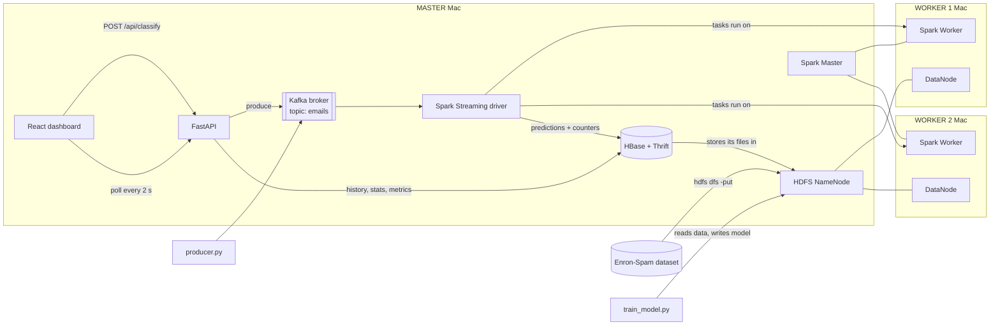

# MailShield: Email Spam Classification Using Big Data Technologies

A spam filter that runs end to end on a **3-machine cluster** (1 master + 2 workers).
Emails stream through **Apache Kafka** and are classified in real time by a
**Spark MLlib** model running on a **Spark standalone cluster**. Results are stored
in **Apache HBase**, and all data, models and checkpoints live in **Hadoop HDFS**.
A **React + Tailwind** dashboard shows the predictions, analytics and cluster health.

| Result | Value |
|---|---|
| Dataset | Enron-Spam, 33,716 emails (≈28,900 unique after cleaning) |
| Model | TF-IDF (65,536 hashed features) + Multinomial Naive Bayes, compared with Logistic Regression |
| Test accuracy / F1 | **≈ 97.8 % / 0.978** on a 20 % hold-out set (≈ 98–99 % on the live labelled stream) |
| End-to-end latency | ≈ 1.5–2.5 s from dashboard → Kafka → Spark → HBase → dashboard |

---

## Architecture



### What each technology does

| Technology | Role in this project | Where you can see it |
|---|---|---|
| **HDFS** | Stores the dataset (16 MB blocks, replication 2 → a copy on each worker), the trained model, the streaming checkpoint, a Parquet archive of every streamed email, and HBase's own data files | NameNode UI `:9870`, `hdfs fsck … -locations` |
| **Spark** (standalone) | **Batch:** cleaning, TF-IDF, training and evaluation of Naive Bayes and Logistic Regression, dataset analytics. **Streaming:** Structured Streaming reads Kafka, applies the model and writes to HBase | Spark UI `:8080` / `:4040` |
| **Kafka** (1 broker, KRaft) | Message queue between email sources (dashboard, producer) and Spark. Decouples them, so no email is lost if Spark restarts | `kafka-console-consumer`, Cluster tab |
| **HBase** (standalone over HDFS) | Low-latency store: one row per classified email, atomic counters for live stats, model metrics and insights | HBase UI `:16010`, `hbase shell` |
| **FastAPI** | REST API plus serving the dashboard. Talks to Kafka (produce), HBase (Thrift), and HDFS/Spark (status) | `http://<master>:8000/docs` |
| **React + Tailwind + Recharts** | Dashboard with Classify, Live Feed, Analytics and Cluster tabs | `http://<master>:8000` |

### Data flow
1. `init-cluster.sh` uploads the dataset to **HDFS** (`/data/emails.jsonl`).
2. `run-train.sh` runs a **Spark** job on the workers. It cleans the text, builds
   TF-IDF features, trains and evaluates the models, and saves the model to
   `hdfs:///models/spam_model`. Metrics and insights go to **HBase** `meta`.
3. Emails enter **Kafka** topic `emails` (2 partitions), either from the dashboard or
   from `run-producer.sh`, which replays labelled emails.
4. `run-stream.sh` runs **Spark Structured Streaming**. Every 2 seconds it reads new
   Kafka messages, cleans the text exactly as in training, predicts, and writes
   each result to **HBase** `emails` (row key = reversed timestamp + id, so newest
   rows come first). It increments counters in `meta` and archives the batch to
   HDFS Parquet. Kafka offsets are checkpointed in HDFS.
5. **FastAPI** reads HBase and serves the **React** dashboard.

### HBase tables
| Table | Row key | Columns |
|---|---|---|
| `emails` | `{9999999999999 − sent_ms}-{id}` | `d:subject d:body d:sender d:source` · `p:label p:p_spam p:confidence p:latency_ms p:true_label p:model p:batch_id p:kafka_partition p:kafka_offset` |
| `meta` | `stats`, `min_YYYYMMDDHHMM`, `model`, `insights` | `c:total c:spam c:ham c:labelled c:correct` (atomic counters) · `m:json` |

---

## Cluster layout and memory

| Mac | Role | Services | Memory caps |
|---|---|---|---|
| MacBook Air M5 16 GB | **Master** | NameNode, Spark Master, Kafka, HBase + Thrift, Spark driver, FastAPI | NN 512 MB, Spark daemon 512 MB, Kafka 512 MB, HBase 1 GB, Thrift 256 MB, driver 1 GB (≈ 4.5 GB in total) |
| MacBook Air M5 16 GB | **Worker 1** | DataNode, Spark Worker (4 cores, 3 GB) | DN 512 MB, executors 1 GB each |
| MacBook Neo 8 GB | **Worker 2** | DataNode, Spark Worker (2 cores, 2 GB) | DN 512 MB, executor 1 GB |

Everything is installed in `/Users/Shared/bigdata`. The path is identical on every Mac,
which Spark needs. No Homebrew, sudo or virtual machines are required.

**Pinned versions:** OpenJDK 11 (Temurin) · Hadoop 3.3.6 · Spark 3.5.9 · Kafka 3.9.1 · HBase 2.5.16 · Python 3.11 · Node 18+.

---

## Setup

### 0. Before you start (all 3 Macs)
- Connect all Macs to the **same Wi-Fi or iPhone hotspot**. College Wi-Fi often blocks Mac-to-Mac traffic.
- **System Settings → Network → Firewall: Off** (or click *Allow* when Java asks).
- When macOS asks whether Terminal may *find devices on your local network*, click **Allow**.
- Master only: **System Settings → General → AirDrop & Handoff → AirPlay Receiver: Off** (it occupies port 7000/5000).
- Keep the Macs awake: run `caffeinate -dims` in a spare terminal and keep the lids open.

### 1. Master
```bash
git clone <this repo> && cd <repo>
cp cluster.env.example cluster.env
ipconfig getifaddr en0                    # -> put this IP in cluster.env as MASTER_IP
scripts/setup-node.sh master              # downloads + installs everything (~1.8 GB, 5-10 min)
scripts/master-start.sh                   # NameNode, Spark Master, Kafka; then waits for a DataNode
```

### 2. Each worker
```bash
git clone <this repo> && cd <repo>
cp cluster.env.example cluster.env        # set MASTER_IP; Neo: WORKER_CORES=2 WORKER_MEMORY=2g
scripts/setup-node.sh worker              # JDK, Hadoop, Spark, Python (~1.3 GB)
scripts/worker-start.sh                   # DataNode + Spark Worker
```
Tip: to skip downloading again, AirDrop the files from the master's `/Users/Shared/bigdata/downloads/`
into the same folder on the worker before running setup.

### 3. Master: initialise, train, stream, serve
```bash
scripts/master-start.sh                   # re-run once workers are up (starts HBase)
scripts/init-cluster.sh                   # HDFS folders + dataset, Kafka topic, HBase tables
scripts/run-train.sh                      # Spark ML training on the cluster (~30 s)
scripts/run-stream.sh                     # terminal 2: real-time classifier (keep running)
scripts/run-app.sh                        # terminal 3: dashboard at http://<MASTER_IP>:8000
scripts/run-producer.sh --rate 20 --count 500   # terminal 4: stream emails into Kafka
scripts/status.sh                         # health check at any time
```

**Testing on one Mac:** `LOCAL_WORKER=1 scripts/master-start.sh` also starts a DataNode and a
Spark Worker on the master. Before switching to the real 3-Mac cluster, run `scripts/reset-cluster.sh`.

**Shutting down:** `scripts/master-stop.sh` on the master and `scripts/worker-stop.sh` on each worker.

---

## Project structure
```
config/      hadoop, spark, kafka, hbase config templates (@MASTER_IP@ etc. filled in by configure.sh)
scripts/     setup-node, configure, master-start/stop, worker-start/stop, init-cluster,
             run-train, run-stream, run-producer, run-app, status, reset-cluster
data/        prepare_data.py (Enron CSV -> JSON Lines)
spark/       common.py (shared cleaning + features), train_model.py, stream_classify.py
producer/    producer.py (replays labelled emails into Kafka)
backend/     app.py (FastAPI)
frontend/    React + Vite + Tailwind + Recharts dashboard
docs/        commands.md (explained commands), demo.md (demo script)
```

## Documentation
- [docs/commands.md](docs/commands.md): HDFS, Spark, Kafka and HBase commands, each with an explanation
- [docs/demo.md](docs/demo.md): step-by-step demonstration script

## Known limitations
- **HBase runs as a single process** on the master (standalone mode) to save memory.
  Its data files are distributed through HDFS. Production deployments would add
  RegionServers on the workers.
- **One Kafka broker** (replication factor 1). Production would use 3 or more brokers.
- **Naive Bayes confidence scores are usually close to 0 or 1.** This is a known property of the
  algorithm. `scripts/run-train.sh --deploy lr` deploys Logistic Regression instead,
  which gives better-calibrated confidence scores.
- **The ham emails all come from Enron**, so company-specific words (`enron`, `vince`, …) are strong ham
  signals. A model for real use would need ham emails from many organisations.
